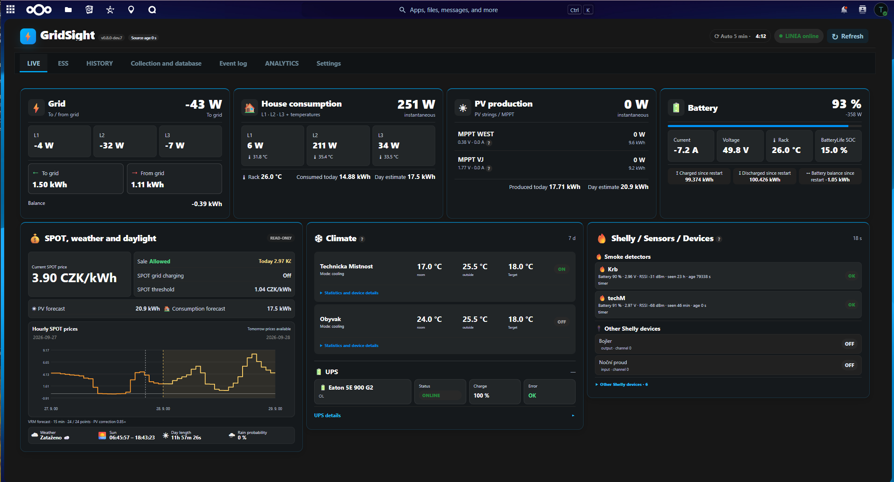

# Hacesoft GridSight – Energy monitoring for Nextcloud

**English** · [Česky](README_CZ.md)

**GridSight** is a read-only monitoring application for Nextcloud 35. It brings photovoltaic production, household electricity use, grid flows, battery status, electricity prices and measurement history into one workspace. Energy telemetry comes from a compatible LINEA API; no remote equipment-control commands are sent.

## Features

- **LIVE overview:** photovoltaic MPPT strings, home consumption, imports and exports, battery and ESS states.
- **History and charts:** recorded energy data, time-range selection, daily totals and interactive 2D/3D charts.
- **SPOT prices and forecasts:** hourly market prices, price threshold, solar/consumption forecasts and available weather data.
- **Optional devices:** Daikin climate, NUT UPS, Shelly devices and sensors when provided by LINEA.
- **Collection and events:** collector/database status, recorded state changes and a clear notice during temporary LINEA API outages.
- **Electricity analysis:** EG.D XLSX imports, contracts, high/low tariffs, HDO schedules, cost calculations and comparison without PV.
- **Delta Green settlements:** manual sale statements and comparison with estimated gross SPOT revenue.
- **Everyday use:** responsive UI, light/dark Nextcloud theme and personal chart settings; 12 interface languages.

## Screenshots

## Getting started

Install the signed release from the [Nextcloud App Store](https://apps.nextcloud.com/apps/hc_gridsight). GridSight requires **Hacesoft Shared App Core 0.18.8 or later**, Nextcloud 35, PHP 8.3+ and a compatible read-only LINEA API (schema 1). See the [installation and requirements guide](docs/en/01_INSTALLATION.md). The `install.sh` source installer is intended for a supported Synology/Docker environment, not as the normal App Store installation method.

## Documentation

- [Application overview](docs/en/README.md) · [Installation and operation](docs/en/01_INSTALLATION.md)
- [LIVE interface and controls](docs/en/02_USAGE.md) · [Data, history and charts](docs/en/03_DATA_AND_HISTORY.md)
- [SPOT pricing and estimates](docs/en/04_SPOT.md) · [Electricity and EG.D analysis](docs/en/05_ELECTRICITY_ANALYSIS.md)
- [Features and notifications](docs/en/06_FEATURES_AND_NOTICES.md) · [LINEA and Nextcloud API / data field reference](docs/en/08_API_AND_DATA_FIELDS.md)

## Project

[Nextcloud App Store](https://apps.nextcloud.com/apps/hc_gridsight) · [Changelog](CHANGELOG.md) · [Report an issue](https://github.com/hacesoft/GridSight/issues) · [License (AGPL-3.0-or-later)](LICENSE)
