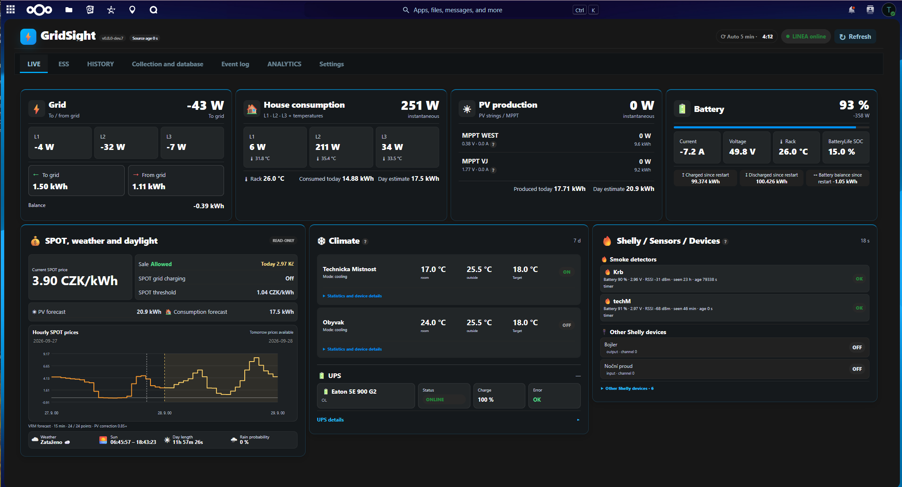

# Hacesoft GridSight – Energetický monitoring pro Nextcloud

**Česky** · [English](README.md)

**GridSight** je aplikace pro Nextcloud 35 určená k přehlednému monitorování fotovoltaiky, spotřeby domu, energetických toků, baterie, cen elektřiny a historie měření. Data čte z kompatibilního LINEA API; technologie pouze sleduje a neposílá povely k jejímu řízení.

## Co aplikace umí

- **Živý přehled (LIVE):** výroba FVE po větvích MPPT, spotřeba domu, odběr a dodávka do sítě, stav baterie a ESS.
- **Historie a grafy:** uložená měření, volba časového období, energetické souhrny a interaktivní grafy 2D/3D.
- **SPOT a předpovědi:** hodinové tržní ceny, cenový práh, odhady výroby a spotřeby a dostupná data o počasí.
- **Volitelná zařízení:** klimatizace Daikin, UPS přes NUT, zařízení a čidla Shelly, pokud údaje poskytuje LINEA.
- **Sběr a události:** stav sběrače a databáze, protokol událostí a srozumitelné oznámení při dočasném výpadku LINEA API.
- **Analýza elektřiny:** import výkazů EG.D (XLSX), smlouvy, vysoký/nízký tarif, rozpis HDO, výpočty nákladů a porovnání domu bez FVE.
- **Vyúčtování Delta Green:** ruční evidence prodeje elektřiny a srovnání s odhadovaným hrubým výnosem SPOT.
- **Pohodlné používání:** responzivní rozhraní, světlý/tmavý motiv Nextcloudu, osobní nastavení grafů a 12 jazyků rozhraní.

## Snímky obrazovky

## Jak začít

Nainstalujte podepsanou verzi z [katalogu aplikací Nextcloud](https://apps.nextcloud.com/apps/hc_gridsight). GridSight vyžaduje **Hacesoft Shared App Core 0.18.8 nebo novější**, Nextcloud 35, PHP 8.3+ a kompatibilní LINEA API schématu 1 pro čtení. Podrobnosti obsahuje [návod k instalaci a požadavkům](docs/cz/01_INSTALACE.md). Zdrojový instalátor `install.sh` slouží pro podporované prostředí Synology/Docker, nikoli jako běžná instalace z App Storu.

## Podrobná dokumentace

- [Přehled aplikace](docs/cz/README.md) · [Instalace a provoz](docs/cz/01_INSTALACE.md)
- [Ovládání LIVE](docs/cz/02_OVLADANI.md) · [Data, historie a grafy](docs/cz/03_DATA_A_HISTORIE.md)
- [SPOT ceny a výpočty](docs/cz/04_SPOT.md) · [Analýza elektřiny a EG.D](docs/cz/05_ANALYZA_ELEKTRINY.md)
- [Funkce a oznámení](docs/cz/06_PREHLED_FUNKCI_A_OZNAMENI.md) · [Reference LINEA a Nextcloud API a datových položek](docs/cz/08_API_A_DATOVA_POLE.md)

## Projekt

[Nextcloud App Store](https://apps.nextcloud.com/apps/hc_gridsight) · [Historie změn](CHANGELOG.cs.md) · [Nahlásit chybu](https://github.com/hacesoft/GridSight/issues) · [Licence (AGPL-3.0-or-later)](LICENSE)
