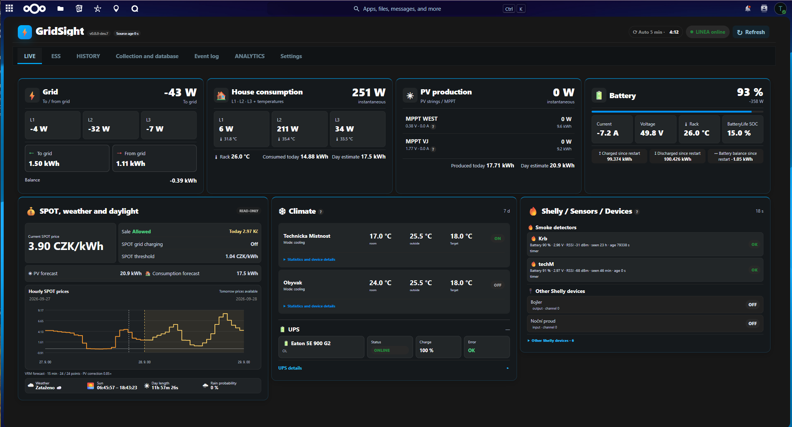

[🇨🇿 Česky](../cz/README.md) | [🇬🇧 **English**](README.md)

# GridSight

GridSight is a read-only Nextcloud 35 application for LINEA API. It displays live solar production, grid flow, battery and ESS state, SPOT prices, other devices and historical measurements. It does not send control commands to the plant.

Its technical app ID is `hc_gridsight`. It requires enabled Shared App Core `>= 0.18.8` and a reachable, read-only LINEA API with schema `1`. For normal use, install the signed release from the **Nextcloud App Store**. The full source ZIP and `install.sh` are intended for supported Synology/Docker installations.

## Screenshot

1. [Installation and operation](01_INSTALLATION.md)
2. [Using GridSight](02_USAGE.md)
3. [Data and history](03_DATA_AND_HISTORY.md)
4. [Daily SPOT calculation](04_SPOT.md)
5. [Electricity analysis and EG.D import](05_ELECTRICITY_ANALYSIS.md)
6. [Full feature and notification reference](06_FEATURES_AND_NOTICES.md)
7. [API and data fields](08_API_AND_DATA_FIELDS.md)

## Languages

The application UI supports all 11 languages: Czech (`cs`), English (`en`), German (`de`), Spanish (`es`), French (`fr`), Italian (`it`), Dutch (`nl`), Polish (`pl`), Portuguese (`pt`), Slovak (`sk`) and Ukrainian (`uk`). Unsupported languages and individual missing translations fall back to English (EN). Every catalog has the same complete key set and preserves message placeholders. Text returned directly by the server or Core components follows those services’ localization. User and technical guides are available in Czech and English. Hungarian (`hu`) is included as a complete additional UI catalog with the same 594 entries as all 11 required languages; technical identifiers and product names remain unchanged.

